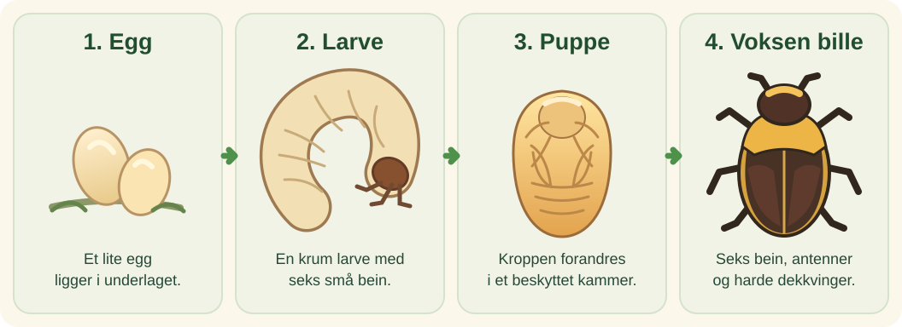

## Fire svært ulike stadier

*Pachnoda marginata* er en rosenbille, og **biller er insekter** – akkurat som maur, bier og sommerfugler. Rosenbillen er et insekt gjennom hele livet, også når den er larve. Den gjennomgår **fullstendig forvandling** i fire stadier: egg, larve, puppe og voksen bille.

Når rosenbillen kommer ut av egget, er den en lys, krumbøyd larve med brunt hode og seks små bein foran på kroppen. Larven lever blant løv og annet nedbrutt plantemateriale. Når den er ferdig utvokst, lager den et beskyttet kammer i underlaget. Der forvandles den til en puppe, før den voksne billen til slutt kommer fram.

<figure class="kryp-weekly-lifecycle">
  
  <figcaption>Forenklet illustrasjon av rosenbillens livssyklus. Stadiene er ikke vist i naturlig størrelse.</figcaption>
</figure>

## Vingene ligger under dekkvingene

Den voksne billen har harde dekkvinger som beskytter de tynnere flygevingene. Som andre insekter har den seks bein og ett par antenner. Larven har også små bein og antenner, men de ser ganske annerledes ut. Den voksne billens form og tydelige farger gjør den lett å kjenne igjen i samlingen.

## Livsstadiet bestemmer oppgaven

Larven bruker mye tid på vekst. Den voksne billen kan bevege seg over større områder og føre arten videre. Det er samme dyr gjennom hele livsløpet, men kropp og oppgave forandres kraftig.

## Prøv selv

Se på illustrasjonen av de fire stadiene. Finn minst én forskjell mellom larven og den voksne billen: Se på farge, form og bein. Prøv gjerne å tegne de fire stadiene i riktig rekkefølge. Du kan også peke og forklare forskjellene høyt i stedet for å skrive.

[Les Korkeasaari dyrehages artsfakta om rosenbillen](https://korkeasaari.fi/en/animal/sun-beetle/){:target="_blank" rel="noopener noreferrer"}

